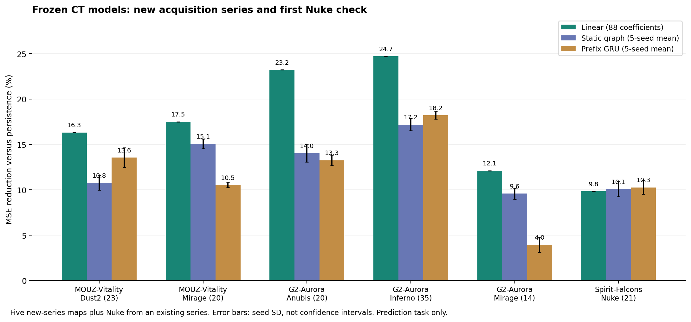

# CT 扩展实验 v3：预测、时间核查与检索对照

日期：2026-10-23。已依次完成模型冻结、少量新采集、扩展预测比较、时钟与比分核查、结构检索诊断、源域别名敏感性检查和离线入口验证。

代码、模型和结果的来源及分发范围见 [来源说明](TAGNET_PROVENANCE.md)，保留上游 MIT 许可。

## 当前结论

**轻量模型的跨地图状态预测结果得到更多支持，当前图向量的检索价值仍未得到支持。** 两项任务应分别验收。现阶段保留线性模型作为预测主对照、共同状态作为检索主对照；图模型继续参与比较。

本轮没有重训或更换冻结的图模型，也没有因 Nuke 的单系列结果新增按地图切换模型的逻辑。图模型在 Nuke 略好，说明线性模型不是普遍最优。尚未启用生产教练建议。

## 1. 范围与冻结

在下载前记录 [扩展协议](../datasets/selections/ct_expansion_v3.json)，冻结共同特征、解析器、线性模型和十个图模型 checkpoint 的 SHA-256。新增两场系列，共五张 Demo，按单进程串行解析；没有继续批量下载。

- 新增 MOUZ–Vitality：Dust2、Mirage。
- 新增 G2–Aurora：Anubis、Inferno、Mirage。
- 追加已下载但尚未用于模型推理的 Spirit–Falcons Nuke。
- 保留既有 FURIA–Falcons、G2–NAVI、Spirit–Falcons 的开发结果。

目标数据共 **5 个系列、12 张比赛地图、6 种地图、263 个完成回合**。其中一个 Dust2 回合不足 20 秒，双阵营快照均明确排除；最终 **262 个有效 CT 回合**，其中新增两系列 **112 个**。另有 Dust2 发布测试 116 回合作为源域开发诊断，不并入目标比赛数。

两场新增系列的队伍组合未出现在上游 33 个源域 match 标签中。但它们已存在于本项目更早的赛事资料中，不能称为全项目盲测；它们是相对于当前 CT 模型的冻结后新采集检查。只有两个新系列，也不支持跨赛事或普通玩家的广泛结论。

## 2. 冻结模型比较

下面是综合状态 MSE 相对“沿用当前观测”的误差降幅。两列图模型使用固定 seed=42，保持与旧主候选一致；完整报告同时保留全部五种子。

| 系列 | 地图 | CT 回合 | 线性模型 | 静态图模型 42 | 前缀 GRU 42 |
| --- | --- | ---: | ---: | ---: | ---: |
| MOUZ–Vitality，新采集 | Dust2 | 23 | 16.32% | 10.27% | 13.18% |
| MOUZ–Vitality，新采集 | Mirage | 20 | 17.51% | 14.82% | 10.34% |
| G2–Aurora，新采集 | Anubis | 20 | 23.23% | 12.59% | 12.96% |
| G2–Aurora，新采集 | Inferno | 35 | 24.72% | 16.28% | 18.36% |
| G2–Aurora，新采集 | Mirage | 14 | 12.11% | 8.81% | 3.83% |
| Spirit–Falcons，首次 Nuke | Nuke | 21 | 9.83% | 11.19% | 10.96% |

两个新增系列按**系列等权**聚合，线性模型误差降幅为 **19.98%**，静态图模型 42 为 **13.79%**，GRU 42 为 **12.97%**。静态图模型的五种子均值为 14.52%，种子标准差 0.46 个百分点；GRU 均值为 13.09%，标准差 0.31 个百分点。种子差异不是独立比赛的不确定性。

所有五个目标系列的等权聚合降幅依次为 17.79%、12.82%、11.81%。协议中的配对系列 bootstrap 已执行，记录原始区间，但不把只有 2/5 个系列的描述性区间作为普遍泛化或显著性证明。



图中两个神经模型显示五种子均值与种子标准差，因此与表中的单种子数值不同。以上均是状态预测误差，不是战术准确率、回合胜率或教练效果。

完整数据：[扩展报告](../datasets/evaluation/ct_expansion_v3_report.json)。

## 3. 引擎时钟、暂停、正式回合与比分

新增独立核查，不改写旧解析器或旧证据：每个可用 CT 回合采样冻结结束及之后 0–20 秒的 21 个时刻，读取引擎 `game_time`、累计暂停 tick、暂停/热身标记、引擎回合开始时间和已完成回合数。

262 个有效 CT 回合全部满足预先固定的条件：引擎时间偏移误差不超过 1/64 秒，窗口内累计暂停 tick 无增加、采样时未暂停/热身、引擎回合号一致、冻结结束与引擎回合开始时间一致。严格时间子集因此与全体有效目标样本相同。

这验证的是这些 Demo 在该窗口内的引擎时钟一致性；不是独立墙钟测量，也未验证上游 697 个源域样本的原始录像。没有据此实现通用暂停校正器。未来出现核查失败的比赛仍须保留失败并单独处理。

新增五张地图的**全部完成回合数和队伍胜局数**均与冻结资料中的公开比分一致。比分来自冻结结束的完整名单及所有回合胜方，不依赖是否能生成 20 秒快照。首次审计曾误用可提取快照中的队名，使那个短 Dust2 回合记成未知；已修复审计、增加回归测试，并保留首次运行。修复未改变模型、样本筛选或预测结果。更早本地系列的公开比分未在本轮重新核对，报告保留未知状态。

## 4. 源域身份风险与敏感性实验

[源域审计](../datasets/evaluation/ct_source_audit_v3.json) 对玩家顺序不敏感地检查了 697 个样本，未发现跨训练/验证/测试的完全重复状态序列。

`monte-vs-natus-vincere_dust2`（训练）与 `natus-vincere-vs-monte_dust2`（验证）存在规范化队伍组合碰撞。它可能是不同赛事，也可能是系列别名；缺少原始来源元数据，不能判定为同一系列，也不能认证严格无泄漏。

为检查这一风险是否主导线性结果，额外移除该组合的训练和验证样本，按相同七个正则化强度重新拟合一个**敏感性对照**：训练从 486 减为 465 回合，验证从 95 减为 78 回合。参数选择仍只看过滤后的源域验证集。新两系列降幅为 **19.84%**，全部五系列为 **17.70%**，与原模型的 19.98%/17.79% 接近。

这只是回顾性稳健性检查，不是新的盲测；未把该对照替换进已冻结模型。[敏感性报告](../datasets/evaluation/ct_alias_sensitivity_v3_report.json)。

## 5. 检索诊断与待审核材料

只从 Dust2 **训练集**生成候选，比较共同状态、静态图 42、GRU 42 及随机对照。以五帧中各自排序的十个玩家间距构造 50 维几何参考。为避免把不存在的玩家对当成零距离，诊断只使用全程五人存活的数据：候选库 404/486 回合，目标查询 226/262 回合；源域发布测试另有 102 个查询。

目标查询上的平均 top-5 候选几何 MSE（越低越好）：

| 检索方法 | 几何 MSE | 几何参考前五邻居重合比例 |
| --- | ---: | ---: |
| 共同状态 | 0.00862 | 7.17% |
| 静态图 42 | 0.01652 | 1.95% |
| GRU 42 | 0.01601 | 2.21% |
| 随机对照 | 0.01987 | 1.24% |

共同状态在各组的这个几何诊断上均优于当前两个图表示。参考同样由输入几何构造，具有明确偏好，不能冒充独立战术标签。这里不报告战术 Recall/nDCG，也不由这个分数判定防守意图、导航通道或战术优劣。[结构检索报告](../datasets/evaluation/ct_structural_retrieval_v3_report.json)。

已导出 [13 个待审核案例、148 个候选](../datasets/evaluation/ct_structural_review_v3.json)：每组取第一个符合五人存活条件的查询，方法名在审核包中隐藏，答案映射单独保存在本地 `output/tagnet/ct_structural_retrieval_v3_checked/method_key.json`。所有人工相关性字段均为 `null`，已完成判断数为 0。该包用于结构观测相关性审核，不足以仅凭状态摘要审核完整战术意图。

## 6. 本项目可运行的应用路径

当前离线路径为：Demo 提取 CT/T 观测 → CT 时间和质量核查 → CT 状态预测/相似观测候选 → 独立审核。预测和检索都携带版本和限制，不将未经审核的结果自动写成战术名称或行动建议。

预测入口沿用 v2 的 CPU 服务。新增检索入口处理完整五帧，按共享有效观测计算距离；死亡导致距离摘要未定义时屏蔽该维度。候选限于训练集，并保守排除与查询相同的队伍组合。例如 G2–NAVI Ancient 检索已真实运行 19 回合，训练候选从 486 减至 466，排除 20 个可能同组合回合。

```powershell
# 使用本轮已提取且时间核查通过的 CT/T 文件；入口只处理 CT。
python scripts/predict_ct_opening.py --snapshots output/tagnet/ct_expansion_v3_checked/2396950__de_mirage_snapshots.json --output output/tagnet/mirage_ct_predictions_example.json
python scripts/retrieve_ct_opening.py --snapshots output/tagnet/ct_expansion_v3_checked/2396940__de_ancient_snapshots.json --output output/tagnet/ancient_ct_neighbors_example.json
```

输出必须使用新路径。检索输出明确标为 `unreviewed`，不包含推断的战术名称或胜率建议。服务未连接 Analyst/Coach/前端，没有向历史图谱或 Milvus 写入任何本轮数据。后续生产接入前仍需独立相关性和完整复盘审核。

## 7. 回归与资源

后续更新：依赖及 Windows 兼容问题已处理，[v4 全量离线验证](CT_VALIDATION_V4.md) 达到 406 项通过。以下数字保留本轮 v3 当时的状态，便于追踪修复过程。

本轮 CT、解析、下载入口及离线网络约束相关 **59 项检查通过**。修复了 Windows 的测试隔离误拦：仅允许标准库 `socketpair` 内部构造所需的回环连接，普通回环和外部 `connect/connect_ex` 仍被测试禁止。

全量回归也已实际尝试，不能标为通过。修改前失败集合与原始 `HEAD` 逐项相同，均为 78 个失败、14 个收集错误；修复 socketpair 后变为 **196 通过、7 失败、14 个收集错误**。剩余错误对应本机缺少 `fastembed/tokenizers`、已安装 `langchain-community 0.4.2` 的旧 Milvus 导入不可用；仓库锁文件记录的是 Python 3.11/0.4.1 环境，当前基础解释器为 Python 3.13。没有升级后台依赖或更改生产检索后端来掩盖验证阻塞。[回归记录](../datasets/evaluation/ct_regression_v3_report.json)。

图模型比较时峰值张量显存约 18.52 MiB，推理结束进程 RSS 约 1.20 GiB；后者是采样工作集，不是 Demo 解析阶段峰值。使用 20% 显存上限与启动前可用内存检查，未并行解析 Demo。CPU 预测和共同状态检索均无需 GPU。

## 复现与下一验收条件

```powershell
output/tagnet/.venv-gpu/Scripts/python.exe scripts/run_ct_expansion.py --output-dir output/tagnet/ct_expansion_reproduce_new
python scripts/evaluate_ct_structural_retrieval.py --expansion-dir output/tagnet/ct_expansion_reproduce_new --output-dir output/tagnet/ct_retrieval_reproduce_new
python scripts/check_ct_alias_sensitivity.py --expansion-dir output/tagnet/ct_expansion_reproduce_new --output-dir output/tagnet/ct_alias_reproduce_new
```

复现需要本地源域数据、原始 Demo 及冻结模型。所有原始 Demo、环境、完整观测、表示与候选保存在忽略目录；公开报告仅保存结果、来源哈希和明确标为未审核的结构摘要。

剩余验收条件是：补齐源域系列来源、增加独立赛事层面的验证、补地图通道/地标语义、独立审核检索相关性和教练证据。**T 方训练未启动**，本轮扩大实验仍优先完成 CT；CT 的结果不能直接外推到 T 方。
