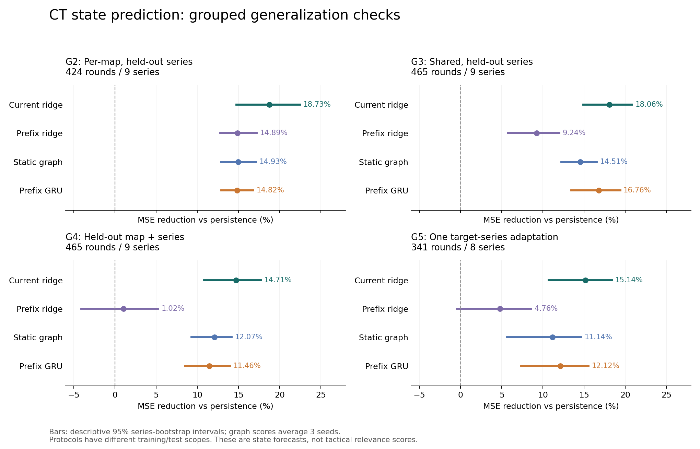

# CT 泛化数值确认：系列、地图留出与少样本适配

日期：2026-10-23。按用户要求暂缓真实后端，本轮完成离线模型评估。

**结论：当前共同特征可以支持有限范围的 CT 状态预测迁移；当前 TAGNet 图模型变体尚未证明优于简单线性对照。不能据此宣布完整战术泛化通过。** 本轮没有发布新的正式模型，也没有把测试结果最好的地图、种子或交叉验证折拼成部署策略。

## 1. 数据与独立性

新增 MOUZ–Falcons、FURIA–Legacy 两个系列、六张 Demo，共 120 个有效 CT 回合。新增回合全部通过引擎时间、阵营/队伍身份和公开地图比分核查。下载第二个系列首次超时，重试相同已选比赛成功；没有因模型成绩追加或替换比赛。[MOUZ–Falcons 公开比分](https://www.hltv.org/matches/2396945/mouz-vs-falcons-blast-open-porto-2026)、[FURIA–Legacy 公开比分](https://www.hltv.org/matches/2396613/furia-vs-legacy-esports-world-cup-2026)。

累计 **9 个系列、22 张比赛地图、6 种地图、466 个完成回合、465 个有效 CT 回合**。一个早于 20 秒结束的历史回合继续跳过。有效样本要求五个时刻均有完整名单且至少一名 CT 存活；结论不覆盖所有实时开局状态。

| 地图 | 有效回合 | 系列数 | 平均“其他区域”存活人数占全队比例 |
| --- | ---: | ---: | ---: |
| Ancient | 84 | 4 | 68.57% |
| Anubis | 41 | 2 | 60.59% |
| Dust2 | 85 | 4 | 70.40% |
| Inferno | 118 | 5 | 52.17% |
| Mirage | 75 | 4 | 49.44% |
| Nuke | 62 | 3 | 78.97% |

所有 465 个窗口均通过时间核查，其中 74 个窗口包含减员，预测评估保留这些样本。新比赛已存在于项目历史资料中，因此只称“本模型冻结后的新采集”，不称全项目盲测。职业队伍之间仍有共享选手/队伍，源域赛事来源不完整，也不称严格的时间、赛事或整支队伍留出。

采集先冻结 [采集协议](../datasets/selections/ct_confirmation_v7.json)，完整训练配方在本轮首次新比赛预测之前冻结于 [训练协议](../datasets/selections/ct_grouped_v7.json)。重训只使用直接解析并核查的九个系列，不使用上游来源未完全核实的 697 个样本。上游训练文件来自干净的 `1a7ac7cf817ba5ba476e94b3bee36046f4fef56c`，精确哈希见权重审核记录。

## 2. 实验矩阵与防泄漏规则

| 任务 | 本轮实施 | 测试量 |
| --- | --- | ---: |
| G1 | 原 Dust2 源域模型和线性权重冻结，直接检查新增两系列 | 120 回合 |
| G2 | 共同特征版本每图独立训练，逐系列留出；另一完整系列作验证 | 20 折，424 回合 |
| G3 | 共享模型逐系列留出；下一完整系列作验证，其余训练 | 9 折，465 回合 |
| G4 | 留出整张地图，同时从训练/验证排除所有包含该地图的系列 | 6 折，465 回合 |
| G5 | 从对应 G4 权重开始，加入该目标地图固定一个系列，测试其他系列 | 6 折，341 回合 |

G2 的 Anubis 只有两个系列，无法划出独立训练、验证、测试，明确记为数据不足。G2 使用当前共同特征，不等于原计划中另建完整地图专用词表的模型已经实现。G5 共使用 124 个支持回合；支持系列固定为每图排序后的第一个，不根据结果挑选。另设从同一 G4 权重出发、只继续源数据训练的控制，逐轮优化步数完全相同，检查收益是否只是来自多训练。验证始终使用源系列。

所有神经模型采用相同三种子 `0/1/42`、最多 40 轮、batch 64、AdamW；只以该折验证误差选择权重。使用既有重建 + 下一状态损失和 64 维图/GRU 结构，不增加架构搜索。线性模型只以训练数据计算标准化统计，七个正则强度只在验证集选择。所有方法推理仅读取当前可见的前缀，采用相同的占用量/死亡下限/距离次序约束。

简单控制包括：持久性、按已观测速度外推、当前十维观测的 ridge（88 个回归系数）、四个因果前缀加时间索引的 ridge（360 个回归系数）。静态图和 GRU 报告三种子的误差均值，**不是挑选最好种子，也不是对预测先做集成平均**。更多历史信息是否有帮助由控制结果判断。

## 3. 主要结果

数值为相对持久性基线的综合状态 MSE 降幅，正值更好。按系列等权，不能把回合当作独立重复；各任务训练和测试范围不同，不直接用跨行差值解释模型增益。

| 任务 | 当前观测 ridge | 前缀 ridge | 静态图，三种子均值 | GRU，三种子均值 |
| --- | ---: | ---: | ---: | ---: |
| G2 每图跨系列 | **18.73%** | 14.89% | 14.93% | 14.82% |
| G3 共享跨系列 | **18.06%** | 9.24% | 14.51% | 16.76% |
| G4 整图与系列留出 | **14.71%** | 1.02% | 12.07% | 11.46% |
| G5 一系列适配 | **15.14%** | 4.76% | 11.14% | 12.12% |



当前 ridge 的 G3 降幅描述区间为 **[14.88%, 20.83%]**，G4 为 **[10.81%, 17.72%]**。G3 中 GRU 相对 ridge 的误差降幅为 **-1.58%**，区间 **[-3.63%, 0.23%]**，不能宣称优于线性，也不把此区间当作已证明二者有差异。G4 的静态图/GRU 相对 ridge 分别为 **-3.09% / -3.81%**，当前队列上的描述区间均在零以下。

区间来自固定种子 2000 次配对系列重采样；系列数量少且共享队伍，训练折也重叠，因此仅作本队列的条件描述，不是跨赛事人群的显著性证明。全部三种子、逐地图、减员/未减员与装备分层结果保存在 [主报告](../datasets/evaluation/ct_grouped_v7_report.json)。

G1 的两个新系列等权降幅为：源域线性 **8.24%**、固定静态图 42 **8.92%**、固定 GRU 42 **7.90%**；仅此新子集上静态图略高，不能隐藏这个结果，也不能据两个系列反向改选模型。累计九系列对应降幅为 **16.16% / 12.01% / 10.97%**。G1 保留历史原始预测评分口径，G2–G5 使用统一约束后的预测，不能把两种口径的分差全归因于训练数据。全部源模型五种子的结果保留于 [误差审核报告](../datasets/evaluation/ct_error_audit_v7_report.json)。

## 4. 收益来自哪里，哪些仍失败

- G3 ridge 的区域/死亡人数分量误差降低 **18.73%**，间距分量降低 **7.72%**；G4 分别为 **15.26% / 1.62%**。跨图收益主要来自粗区域人数变化，不是已学会导航连通性。
- G3 ridge 的 10→12 秒预测改善较明显，18→20 秒改善较小；GRU 在后一个时段较好，未形成总体优势。完整四个时段和八个分量见误差审核报告。
- G4 GRU 的死亡人数分量比持久性基线略差，误差增加约 **2.32%**。不能宣称每个预测分量都改善。T 出生区分量在本队列基本没有变化，不视为单独的有效能力证据。
- 速度外推在 G3/G4 的综合误差约增加 **60%**；加入完整历史前缀的 ridge 也未超过当前观测 ridge，G4 区间跨零。复杂度与可见历史更多并不自动带来迁移收益。
- G5 必须与 **同一 341 回合子集**上的 G4 比。ridge、静态图、GRU 的额外误差降幅分别为 **2.79% / 1.16% / 2.95%**。神经方法对照相同步数的源域继续训练，额外降幅为 **2.12% / 3.93%**。这支持本轮固定支持集下有限的适配效果，不是不同支持抽样或 1/3/5 系列学习曲线已完成。
- 区域仍只有 A/B/双方出生区/其他；“其他”占比很高，Nuke 未加入楼层或导航语义。当前模型是 TAGNet 结构的研究变体和粗状态探针，不是完整战术分类器。

## 5. 检索与独立战术相关性

将原冻结编码器的公平窗口诊断扩展到九系列：391 个全程五人存活查询，74 个减员窗口仅在此几何诊断排除；候选仍为 Dust2 训练集全存活样本，并排除相同队伍组合。

完整五帧 top-5 几何 MSE：共同状态序列 **0.008440**、包含血量/装备的简单序列 **0.008574**、静态图序列 **0.015095**、GRU 最后向量 **0.015512**。这个构造的几何参考下，简单控制仍更好。[检索诊断报告](../datasets/evaluation/ct_retrieval_horizon_v7_report.json)。它检查的是原冻结编码器，不等于新交叉验证编码器的战术相关性也已测量。

[审核包](../datasets/evaluation/ct_structural_review_v7.json)扩为 **22 个查询、280 个候选、0 个人工判断**。候选合并后隐藏方法并打乱顺序，映射保留本地。材料仍主要是结构摘要，不足以独立判断完整战术意图；没有自动代填人工标签，没有发布战术 Recall/nDCG 或教练收益。

## 6. 验证、资源与复现

全量离线回归 **416 项通过，3 项第三方弃用警告**。合成流程试跑仅验证脚本执行，不计入效果数据。真实权重审核覆盖全部 **282 份权重**，每折取第一个测试窗口，逐一改变未来四个前缀边界，未发现较早预测读取未来观测；玩家排列最大差 **4.7535e-6**，低于预定 `1e-5` 容差。主比较的保存预测未发现占用和、死亡下限或距离次序约束违反。[权重审核](../datasets/evaluation/ct_weight_audit_v7_report.json)、[验证凭据](../datasets/evaluation/ct_confirmation_validation_v7.json)。

重训总耗时 **18.83 分钟**，峰值张量显存约 **50.54 MiB**、进程峰值内存约 **1.55 GiB**；GPU 驱动上下文和其他程序占用另计。全程单 Demo 解析、单训练进程，GPU 进程显存上限 20%，开始至少 2 GiB 可用内存、训练至少 1.5 GiB。未触发资源停止条件。

本机精确派生数据、Demo、分折权重保留在忽略目录；公开凭据提供原始 Demo 与派生快照校验值。以下重训要求先恢复相同输入目录，并使用新输出目录；不是无数据的新克隆一键复现。实际 GPU 环境为 PyTorch 2.14.1+cu130，demoparser2 0.41.3，矩阵精度 IEEE、cuDNN RNN TF32。

```powershell
# 模型配方、特征与源权重的冻结哈希在启动和结束时复核。
output/tagnet/.venv-gpu/Scripts/python.exe scripts/confirm_ct_generalization.py --protocol datasets/selections/ct_grouped_v7.json --expansion-dirs output/tagnet/ct_expansion_v3_checked output/tagnet/ct_event_transfer_v5_verified output/tagnet/ct_confirmation_2396945_v7 output/tagnet/ct_confirmation_2396613_v7 --output-dir output/tagnet/ct_grouped_v7_reproduce
output/tagnet/.venv-regression/Scripts/python.exe scripts/summarize_ct_confirmation.py --run-dir output/tagnet/ct_grouped_v7_reproduce --acquisition-protocol datasets/selections/ct_confirmation_v7.json --output output/tagnet/ct_grouped_v7_reproduce/error_audit.json
output/tagnet/.venv-gpu/Scripts/python.exe scripts/audit_ct_forecasts.py --run-dir output/tagnet/ct_grouped_v7_reproduce --output output/tagnet/ct_grouped_v7_reproduce/weight_audit.json
```

## 7. 验收与项目应用结论

| 判断 | 状态 | 范围 |
| --- | --- | --- |
| G1 冻结模型检查 | Verified | 两个新增系列及累计九系列的粗状态预测 |
| G2 单地图适配控制 | Verified / 数据不足 | 五种地图已完成；Anubis 不具备三份独立划分 |
| G3/G4 数值迁移 | Verified | 固定队列、共同特征和当前损失下优于持久性 |
| G5 一系列适配 | Verified | 一次固定支持选择与匹配继续训练控制；其他剂量/抽样未验证 |
| 图/时序模型优于简单模型 | 未建立 | 当前 ridge 在四项任务中总体更好 |
| 独立战术相关性、完整地图语义、教练收益 | Unknown | 需要可核对上下文和独立人工标注 |
| T 开局训练、真实后端 | 未验收 / 暂缓 | CT 结论不外推到 T；后端按用户要求暂缓 |

本项目继续保留线性状态预测和可追溯的候选输出作为离线控制。新权重用于逐折复核，不把测试折最优权重直接当正式产品模型。只有在独立战术相关性和地图语义上补齐证据，才有依据讨论把某个表示用于 Coach 的战术建议。本轮关闭的是这份有限数据上的数值实验矩阵，不是原方案所有研究目标的总验收。
