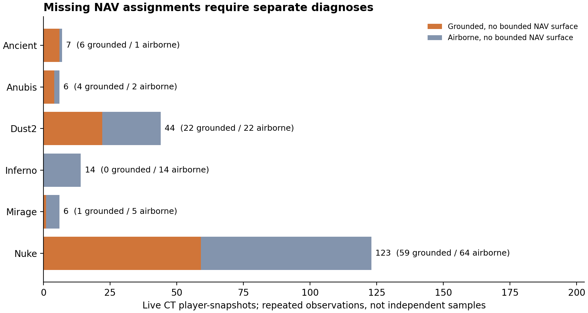

# CT 地图上下文核查与独立评审试点 v9

2026-10-23。**完成腾空状态重读、两版静态资产对照及可直接评分的离线试点材料；真实专家评分仍为零。** 本轮全部使用已看过的九个开发系列，没有新模型训练，也没有新增 Demo 下载。承接 [v8 研究协议](CT_STUDY_PROTOCOL_V8.md)和[导航定位修复](CT_RESEARCH_PROGRESS_V8.md)。

## 1. 未定位点不能全部解释成网格缺失

从 22 份原始 Demo 顺序补读同一 tick 的 `is_airborne`，逐项核对既有五名 CT 的坐标、血量、装备和区域。**11,625 次玩家快照全部与冻结数据一致**；其中 11,368 次存活观测纳入定位诊断，895 次处于腾空状态，没有缺失的腾空标志。

这里使用的是 demoparser2 基于 `m_hGroundEntity` 的引擎状态标志，不用稀疏 tick 之间的速度估计代替。[字段来源](https://github.com/LaihoE/demoparser/blob/45ca85aeac8fb0de9d385124d2c7fe0e7b8ff0c8/README.md)。标志本身也不是专家战术标签。

| 地图 | 存活观测 | 腾空 | 地面状态 | 地面可定位候选 | 地面未定位 |
| --- | ---: | ---: | ---: | ---: | ---: |
| Ancient | 2,049 | 105 | 1,944 | 1,938 | 6 |
| Anubis | 1,017 | 54 | 963 | 959 | 4 |
| Dust2 | 2,062 | 149 | 1,913 | 1,891 | 22 |
| Inferno | 2,896 | 303 | 2,593 | 2,593 | 0 |
| Mirage | 1,833 | 161 | 1,672 | 1,671 | 1 |
| Nuke | 1,511 | 123 | 1,388 | 1,329 | 59 |
| 合计 | 11,368 | 895 | 10,473 | 10,381 | 92 |

v8 的 200 次未定位观测中，**108 次腾空、92 次地面状态**。不能将移除空中观测后分母变化产生的比例，包装成模型或几何正确率提升。895 次腾空观测中还有 787 次原本能找到附近 NAV 表面，后续也不能因此默认其地面通行关系有效。



新组件 `grounded_candidate` 对腾空或未知状态保留相应状态，不分配地面导航候选；位置、地名和原始状态仍保留。地面候选使用 v8 的有界定位，并检查脚部上方 16 单位的投影连线是否被可见性网格遮挡。本轮 10,381 个地面候选均未被该射线拦截，**这不能证明不存在穿墙或可供玩家通行**。

## 2. 历史资产和当前资产分别核查

找到 Awpy-data 的 [2000880](https://github.com/pnxenopoulos/awpy-data/releases/tag/2000880)、[2000883](https://github.com/pnxenopoulos/awpy-data/releases/tag/2000883)及[2000934](https://github.com/pnxenopoulos/awpy-data/releases/tag/2000934)资产。前两者 manifest 均记录补丁 14174，当前为 14191。下载包及解出的实际文件逐项核对哈希；2000934 的六图 NAV 与本机提取结果相同。获取清单见 `datasets/selections/ct_map_assets_v9.json`，它是事后开发资料记录，不是正式预注册。

2000880 与 2000883 的六图 NAV 字节一致。2000883 与 2000934 中，Anubis、Dust2、Inferno、Mirage、Nuke 的 Awpy 暴露区域记录、几何和连接一致；**Ancient 有实际变化**。忽略区域 ID 重编号后，当前版独有 13 个多边形、历史版独有 14 个，按形状匹配的有向连接集合也不同。直接比较 ID 会把 1,817 个共有 ID 的记录差异误当成同等数量的空间变化，核查代码单独处理了这一点。

两个版本对本批观测的定位与状态**汇总计数相同**，不表示地图完全相同。19 份 Demo 的补丁号可与 2000883 对应；3 份 14165 Demo 未找到同补丁的 Awpy-data 发布。即使补丁号一致，也未取得 Demo 服务器的精确 ClientVersion 或地图校验值，不能宣布历史兼容全部通过。

## 3. Nuke Rafters 的残留问题

原 92 次 Rafters 未定位观测分为 **39 次腾空、53 次地面状态**。对 53 次地面未定位位置，在当前 Nuke 未筛选、未简化的 world physics 中，从脚上 2 单位向脚下 16 单位探测，**39 次检测到附近静态碰撞面**。

这支持“至少部分可站立附近表面没有被 NAV 覆盖”的解释；历史与当前 Nuke 暴露 NAV 相同，使单纯更换这两个导航版本无法解决该问题。其余 14 次没有近处 world-physics 命中，还可能涉及独立实体碰撞、资产版本或状态解释，保留未知。

原始 NAV 没有增添多边形或连接。未用目标比赛的玩家轨迹补造通路，也没有将脚下碰撞面自动认定为可通行节点。

完整碰撞来源是本机 `world_physics.vmdl_c`，Source2Viewer CLI 20.0.6980 导出后，使用 [Awpy-data 固定提交](https://github.com/pnxenopoulos/awpy-data/tree/7c73907f74521d271f0eb40bcbe14a4912184e05)的 `process_geometry.py --drop --no-decimate` 转换，191,628 个三角形。公开 Awpy 可见性网格会去掉 clip、玻璃等，并作简化，因此不能替代玩家碰撞网格。[上游处理说明](https://github.com/pnxenopoulos/awpy-data#collision-meshes)。world physics 也不等于所有实体或动态碰撞。

## 4. 评审材料与分发

后续按用户要求改为[60 条人工、59 条 AI 银标](CT_HUMAN_SILVER_V10.md)。已发 Q01/Q02/Q03 保留；新增人工使用 v10 的四个小包。以下完整分发版保留作来源记录，不再要求将余下全部包发给人。

**当前使用中文易读版 r3**：`output/tagnet/ct_semantic_pilot_v9_distributed_r3_zh/CT-12题包-分发合集.zip`。仍为 12 包、每包 9–10 题，题目没有增删。地图名和本批出现的 92 个地图/位置组合均用中文显示，按地图区分同名位置；原始快照中的名称保留。中文采用常用或描述性叫法，不作为经过专家认证的报点词典。

面向普通测试人员，不要求专业 CS2 资格。“部署参考相关性／结构相似性”改写为“右边的站位，对左边有没有参考？／两边的人员分布和移动像不像？”，说明只讲看图、选分、写一句原因和导出；经验可不填，看不懂可选“看不出来”。只检查了中文显示、直接评分和导出，未重复全套测试。普通参与者的回答不能标为专业战术评审；新版本单独记录，不自动与旧说明下的评分合并。清单见 `datasets/evaluation/ct_semantic_pilot_distributed_zh_v9_report.json`。

以下为此前版本记录。

**当前改用分发版 r2：12 个独立题包，每包 9–10 条，不同人领取不同包，共 119 条且无重复。** 不需要每人做同一份 24 条。按实际人数逐包发放，未发出的包保持未评；无需同时做区域核查表。

材料位于 `output/tagnet/ct_semantic_pilot_v9_distributed_r2/`。组织者解压 `CT-12题包-分发合集.zip`，按 `分发清单.txt` 将不同的 `CT-Qxx.zip` 分给不同人；合集不包含分析对应表。评审先解压收到的题包，再用 Chrome/Edge 打开 `review.html`，**自动分配匿名代号，直接可评分**，无需先点击开始。结束后导出 JSON 交回；不要在聊天或压缩包预览内填写。`analyst_key.json` 仅供组织者本机分析。

此修复取消原页面必须手动启动才解锁的门槛，浏览器存储不可用时也允许评分和导出。只检查了本次相关的分包无重复、打开后评分、导出和恢复，没有重跑训练或全套回归。原 24 条版本另存修复包 `output/tagnet/ct_semantic_pilot_v9_short24_r2/ct-reviewer-kit-v9-short24.zip`；以分发版为当前安排。

分发版保留原候选与匿名标签，没有重新挑选结果。材料仍是开发资料上的评分试点；无同题重叠的分配不能计算同题评审一致性，不据此声称模型泛化有效。原有 Q04 补丁提示和 CT 信息边界继续生效。公开清单为 `datasets/evaluation/ct_semantic_pilot_distributed_v9_report.json`。

以下保留此前短版和完整版的制作记录。

**首轮改用短版：每位评审 24 条，12 个查询各看 2 个候选，覆盖六张地图。** 先检查材料是否足够判断、评分规则是否清楚；105 项区域核查不同时布置。短版评分包为 `output/tagnet/ct_semantic_pilot_v9_short24/ct-reviewer-kit-v9-short24.zip`，仅含评分页与说明；同目录的 `analyst_key.json` 不发送。119 条完整版保留，暂不要求填写。

短版从已冻结的完整版提取共同状态检索第 1 名，以及首个与其不同的随机候选，再独立打乱并重新匿名编号。随机候选遇到重合会跳过，因此这不是无偏方法比较；每查询两个候选也不能计算 nDCG@5。**仅用于流程试点，不支持正式模型效果或论文有效性结论。** Q04 补丁差异、CT 信息缺失等原有限制继续保留。短版使用独立版本号、内容哈希和导出文件名，与完整版的浏览器进度和评分隔离；真实专家评分仍为零。

复建使用 `scripts/shorten_ct_semantic_pilot.py --source-dir output/tagnet/ct_semantic_pilot_v9_checked --output-dir <新目录>`；清单见 `datasets/evaluation/ct_semantic_pilot_short24_v9_report.json`。

短版追加验证：全套回归 444 passed（3 个既有警告）；浏览器确认 24 条、暂停恢复、独立导出文件名以及 0 分/无法判断分开存储，控制台无错误。导出使用明确标注的模拟示例，不计入真实评分；压缩包仅含评分页和说明。既有 v7/v8 共 23 项冻结制品哈希保持一致。未重新训练或使用 GPU。

用户已表示可以在材料就绪后安排两位独立评审。当前生成：

- `output/tagnet/ct_semantic_pilot_v9_checked/review.html`：自包含的离线评分页，含底图、匿名 A–E 玩家、五个时刻、Nuke 上下层、状态表、两项等级和理由。没有外部请求或自动提交。
- 同目录 `ct-reviewer-kit-v9.zip`：仅含评分页及简短说明，可分别交给两位评审。**不要把同目录的 `analyst_key.json` 或整个开发目录一并发送。**
- `datasets/evaluation/ct_map_role_review_v9.json`：105 个地图区域组合的核查队列，含真实回合/tick 线索和地面问题计数。所有 `approved_roles` 仍为 null、评审判断为空；词面角色候选不是已接受标签。

试点按每图两个不同系列选取 **12 个查询、119 个候选条目**，优先匹配底图补丁，再按固定种子 20261023 的哈希顺序选取。每个查询的候选库排除**所有包含该查询地图的系列**，并只使用补丁 14174 的源地图回合。候选池由共同状态检索 top-5 与确定性随机对照 top-5 合并、去重并随机排列；这用于检验评分流程，**不是图模型与简单模型的正式效果比较**。方法对应和原始系列信息只留在本机分析表，评分页不含它们。

11 个查询补丁为 14174；Anubis 仅有两个开发系列，因此 Q04 必须来自旧补丁 14165，界面明确提示底图兼容未核实，允许弃评。不得将该例当作版本兼容已经确认的正式测试。底图投影采用 Awpy 的 `world_to_pixel` 直接坐标公式；已检查 Dust2 的点位显示，不额外将 overview 的 rotate/zoom 字段施加到原始雷达图上。

评审使用 R1/R2 等不同代号，独立评价“部署参考相关性”和“结构相似性”，并写简短理由。0 分、无法判断、尚未完成分开存储。可暂停续填；浏览器保存不是正式备份，每次暂停都应导出 JSON，并保持同一浏览器及文件位置。界面记录的会话时长只是页面打开时间，不是精确工作时长。由组织者处理适用的参与和机构流程，本工具不代替相关安排。

## 5. 复跑和后续接入

```powershell
# 顺序重读：同一 v7 run、两版已核实资产及原 Demo 文件夹
& E:/Anaconda/python.exe scripts/audit_ct_ground_navigation.py --help
# 静态比较与区域核查队列
& E:/Anaconda/python.exe scripts/prepare_ct_map_review.py --help
# 从核查结果和 2000883 雷达资产生成评分材料
& E:/Anaconda/python.exe scripts/build_ct_semantic_pilot.py --help
```

各输出须用新目录；真实评审填写导出的评分文件另存，不能覆盖原始空白材料。公开仓库仅提交代码、哈希、派生核查与制品清单；Valve 底图、几何、Demo、分析对应表和含图离线包留在本机。

重建 Nuke 完整碰撞时，Source2Viewer 精确提取 `maps/de_nuke/world_physics.vmdl_c`，再用 `-d --gltf_export_format glb` 导出。该版本会同时写出一个空的常规模型 GLB 和真正的 `*_physics.glb`，转换器必须读取后者。按上述固定提交取得 `process_geometry.py`、`lib.py` 与许可证，以 `--drop --no-decimate` 转为 AWMH；具体输入/输出哈希在获取清单中。

## 6. 验证与验收边界

全套离线回归 **439 passed，3 个既有弃用警告**。v7 的 18 项冻结代码/权重和 v8 的 5 项核查制品哈希全部保持一致。新增检查涵盖腾空/未知状态拒绝、射线否决、区域重编号与几何变化区分，以及查询/候选整系列隔离。

Playwright 在本机静态预览中检查了底图加载、方法名隐藏、0 分与未知分开、保存与恢复位置、Nuke 上下层、时间滑块、Q04 版本提示、断网后的导出和手机宽度。模拟导出明确标为 `TEST_ONLY_R1`，不是真实评审，未填入公开评审数据；浏览器检查无页面错误。浏览器工具不允许 file 协议，直接双击文件的运行方式未在该工具中验证。临时浏览器和两个仅绑定本机的预览服务已关闭。

完整上下文核查约 26.96 秒，结束时 RSS 374.79 MiB，非峰值；设有可用内存门槛，未使用 GPU。累计下载的资产压缩包约 123.94 MiB，没有新比赛下载。详见 `datasets/evaluation/ct_context_validation_v9.json`。

本轮只完成开发资料诊断与评审准备，真实专家评分、区域角色验收、历史精确版本兼容和玩家碰撞/通行关系仍待完成。评分规则或材料实质变更须另立版本并保留原记录，不能与本轮评分混用。

后续为新共同特征保留 `airborne / unknown / inside / snap / ray-blocked` 及残差、有效性掩码。暂不把候选距离接入模型，也不对既有 v7 结果重新解释为战术效果。先完成区域和部署评分试点，分析分歧与材料缺失，再冻结正式特征、主比较、样本量和新测试清单。真实后端和 T 方训练继续暂缓。
