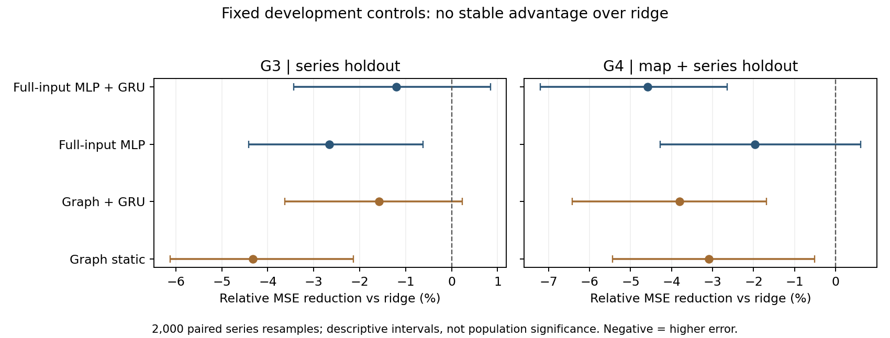

# Auxiliary CT state-prediction evidence supplement

The active full-paper framework is [manuscript/main.tex](manuscript/main.tex), with section/experiment tracking in the [writing guide](README.md). This file preserves the completed numerical evidence; it is not a second manuscript or a change of the main deployment-representation task.

Status: working Methods, Results and Limitations sections, not a submission-ready paper. Human annotation is paused at the user's request. These numerical results use previously observed development data. No tactical efficacy, coaching benefit or superiority of the original TAGNet task is established.

## Methods

We studied 465 eligible Counter-Strike 2 defensive-side opening windows from 22 Demos across nine series and six maps. Each window contains observations at 10, 12, 15, 18 and 20 seconds after freeze time. The shared eight-dimensional state comprises five live-region fractions, the dead-player fraction, and the mean and maximum live-pair Euclidean distances. Distances are divided by a fixed 5,000-game-unit scale. Undefined pair statistics are masked. Seventy-four windows contain casualties; these remain in prediction evaluation.

The original TAGNet study concerns snapshot reconstruction and unsupervised defensive-pattern discovery. Our next-state prediction task is an auxiliary representation probe. It is not a like-for-like reproduction of tactical clustering quality. The original fixed random temporal/context aggregation and our trained GRU variants must also be distinguished. Provenance is recorded in [TAGNet provenance](../TAGNET_PROVENANCE.md).

All train/validation/test partitions are separated by complete series. G2 trains map-specific shared-feature models; Anubis is omitted because only two series are available. G3 leaves one series out. G4 leaves out a map and removes every series containing that map from both training and validation. G5 adds one fixed target-map support series and tests on the remaining target series. Preprocessing and regularization selection use only training and validation data. Neural results average errors over seeds 0, 1 and 42, rather than selecting the most favorable seed.

The v14 exploratory comparison retains the exact G3/G4 folds, target masks, prediction constraints and seven ridge penalties from v7. The base model has ten current-frame features. Node summaries add ten role-conditioned live health/equipment sums and two live health/equipment standard deviations. Pair summaries add ten sorted live-pair distances and ten padding-validity indicators. Combined summaries contain 42 inputs and 344 fitted regression coefficients including intercepts. These summaries are permutation-invariant and use the same raw node/edge sources, but discard associations; they do not constitute a complete-information set-model control.

The v17 non-graph control reads the full masked five-player node matrix, full pair-distance matrix and alive mask (70 scalar inputs). It applies the same MLP to all 120 joint node/edge permutations and averages the embeddings. This preserves the incidence between each edge and its endpoints in every network input while enforcing permutation invariance. Static and causal-GRU variants use the same loss, 40 epochs, batch size, optimizer steps and validation selection as the cached graph controls. The model has 59,984 parameters versus 78,419 for the graph comparator. Averaging all permutations incurs extra computation; the comparison is not compute- or parameter-matched.

We report relative reductions in equal-series mean squared error. Paired series bootstrap intervals use 2,000 resamples and seed 20261023. They are conditional descriptive intervals: there are few series, teams overlap, and training folds overlap. The cohort has already been inspected, so none of these results are untouched confirmatory tests.

## Results

Table 1. v7 relative error reduction versus persistence (%); settings have different test subsets and must not be compared by subtracting rows.

| Setting | Test windows | Current ridge | Prefix ridge | Static graph | GRU |
|---|---:|---:|---:|---:|---:|
| G2 | 424 | 18.73 | 14.89 | 14.93 | 14.82 |
| G3 | 465 | 18.06 | 9.24 | 14.51 | 16.76 |
| G4 | 465 | 14.71 | 1.02 | 12.07 | 11.46 |
| G5 | 341 | 15.14 | 4.76 | 11.14 | 12.12 |

Current ridge was the strongest overall method in these four v7 settings. This does not establish that the original TAGNet clustering task is inferior to linear prediction. On the two newly acquired series alone in G1, the frozen static graph seed 42 slightly exceeded the frozen linear model (8.92% versus 8.24% reduction). That positive detail is retained; G1 also uses a different historical prediction-scoring convention.

Table 2. v14 fixed richer-summary controls: reduction versus persistence, followed by paired reduction versus the original ridge and its descriptive interval. Positive values favor the listed method.

| Setting | Control | Inputs | vs persistence (%) | vs ridge (%) | Descriptive interval vs ridge (%) |
|---|---|---:|---:|---:|---|
| G3 | ridge | 10 | 18.06 | 0.00 | [0.00, 0.00] |
| G3 | node_ridge | 22 | 17.66 | -0.48 | [-1.42, 0.25] |
| G3 | pair_ridge | 30 | 17.75 | -0.38 | [-1.75, 0.60] |
| G3 | pooled_ridge | 42 | 18.24 | 0.23 | [-0.50, 0.85] |
| G4 | ridge | 10 | 14.71 | 0.00 | [0.00, 0.00] |
| G4 | node_ridge | 22 | 14.19 | -0.61 | [-1.29, 0.10] |
| G4 | pair_ridge | 30 | 14.60 | -0.13 | [-0.91, 0.63] |
| G4 | pooled_ridge | 42 | 14.01 | -0.82 | [-2.30, 0.50] |

The combined summary yields only a 0.23% paired reduction relative to ridge in G3, with an interval spanning zero. In G4 it increases error by 0.82%, again with an interval spanning zero. Neither added group alone gives a consistent improvement. These results do not support adopting the richer summaries as a superior model; all four conditions remain reported. The reproduced base-ridge forecasts differ from the saved v7 predictions by at most 7.78e-16.

Table 3. v17 full-input controls: equal-series relative reduction versus persistence (%), and paired reduction versus ridge with descriptive intervals. All 90 additional models were trained under the fixed recipe.

| Setting | Method | vs persistence (%) | vs ridge (%) | Descriptive interval (%) |
|---|---|---:|---:|---|
| G3 | Graph static | 14.51 | -4.32 | [-6.13, -2.14] |
| G3 | Graph + GRU | 16.76 | -1.58 | [-3.63, 0.23] |
| G3 | Full-input MLP | 15.88 | -2.66 | [-4.42, -0.62] |
| G3 | Full-input MLP + GRU | 17.07 | -1.20 | [-3.43, 0.84] |
| G4 | Graph static | 12.07 | -3.09 | [-5.45, -0.51] |
| G4 | Graph + GRU | 11.46 | -3.81 | [-6.42, -1.69] |
| G4 | Full-input MLP | 13.03 | -1.97 | [-4.28, 0.61] |
| G4 | Full-input MLP + GRU | 10.80 | -4.59 | [-7.20, -2.65] |

The full-input static MLP outperforms the cached static graph in point estimates in both settings, but neither new control establishes an advantage over ridge. G3 full-input GRU remains inconclusive relative to ridge; G4 full-input GRU has higher error. This fixed development recipe does not establish a graph-structure advantage, nor prove that no graph model could be useful.

The separate experimental geometry export covers all 465 windows with 15 node descriptors and two pair descriptors. It separates horizontal distances, relative heights, airborne/unknown state and masked NAV-candidate residuals. Only 8,979 of 11,368 live observations retain projection validity after the historical patch-number gate; this is a validity filter, not an improvement in localization accuracy. This representation has not been trained or judged as tactical semantics.

Table 4. Failures and constraints that accompany the aggregate results.

| Observation | Evidence | Consequence |
|---|---|---|
| Coarse state dominates improvement | G4 ridge region/death components improve 15.26%, distances only 1.62% | Do not infer learned navigation or tactical intent |
| More history is not uniformly helpful | G4 prefix ridge improves only 1.02% versus persistence | A longer prefix is not automatically better transfer |
| A neural component can degrade | G4 GRU death-count error increases about 2.32% versus persistence | Report per-component failures |
| Map vocabularies lose detail | The frozen six-map input audit maps 50.57–81.01% of live observations to other | Static role/route semantics remain unresolved; this is a category fraction, not model error |
| Geometry retrieval is a proxy | Five-frame top-5 geometric MSE: common 0.008440, static 0.015095, GRU 0.015512 | Do not call this tactical relevance |

## Limitations and work remaining

No independent tactical endpoint is established. Human responses and developer-involved AI silver judgments are separate pilot evidence and are not used for this experiment. Their workstream is paused. The geometric retrieval diagnostic uses the original frozen encoders and a Dust2 training library, not the newly cross-validated encoders. Shared teams and the small number of series prevent population-level conclusions. Target-map static geometry access must be disclosed when future map semantics are evaluated; historical patch compatibility is not fully established.

The v17 full-input non-graph control now addresses the raw-input omission of the v14 pooled statistics, while compute and parameter differences remain explicit. It gives no stable advantage over ridge. New geometry is implemented and audited separately; no predictive improvement from geometry is claimed. New semantic roles, navigable distances and clustering claims also require separate evidence. A new untouched test cohort should be collected only after the recipe, primary comparison, sampling budget and stopping rule are fixed. Original-task reconstruction/clustering reproduction remains a separate track. Related work, publication novelty, statistical power and submission requirements need separate verification before manuscript completion.

## v14 reproducibility pointers

- [v7 numerical report](../../datasets/evaluation/ct_grouped_v7_report.json)
- [v14 fixed development recipe](../../datasets/selections/ct_pooled_ridge_v14.json)
- [v14 results and artifact receipts](../../datasets/evaluation/ct_pooled_ridge_v14_report.json)
- [Run script](../../scripts/evaluate_ct_pooled_ridge.py)
- Only two targeted synthetic tests were run for the new summaries: permutation/causality and missing-pair/invalid-distance handling. Full regression and GPU retraining were not repeated.
- v14 used no new Demos or GPU; elapsed fitting/evaluation was approximately 1.58 seconds, with process peak working set approximately 56.37 MiB. RAM guards require 2 GiB at start and 1.5 GiB during fitting. Raw Demos, weights and map images remain local and are not bundled for redistribution.

## v17 implementation receipts

- [Fixed training recipe](../../datasets/selections/ct_information_control_v17.json)
- [90-weight results, each seed and failure groups](../../datasets/evaluation/ct_information_control_v17_report.json)
- [Separate geometry coverage](../../datasets/evaluation/ct_geometry_features_v17_report.json)
- Four targeted synthetic tests passed. Two selected trained checkpoints were also checked on the fixed first test row: maximum permutation difference 5.96e-8; all earlier-prefix changes under future perturbation were zero. This is not a full-suite or tactical validation claim.
- Training took 209.22 seconds; peak allocated tensor VRAM 124.25 MiB, process peak working set 1,526.83 MiB. CUDA driver context and other processes are separate. No new Demos were downloaded.
